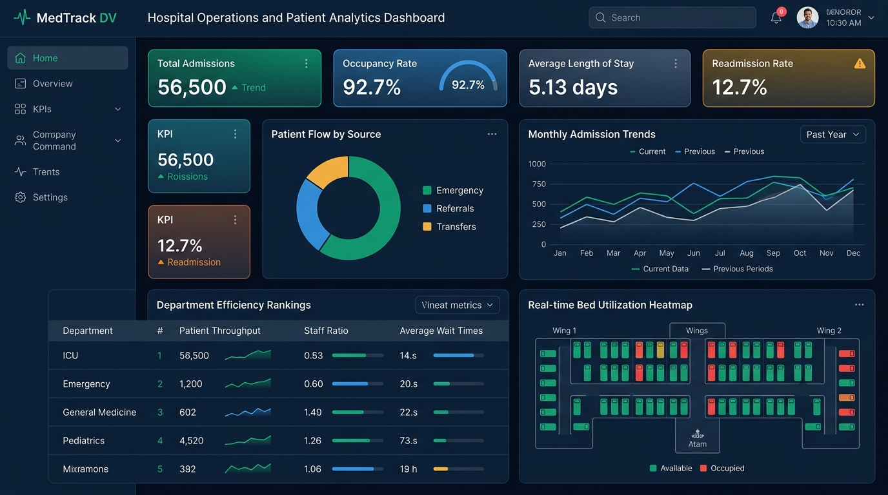
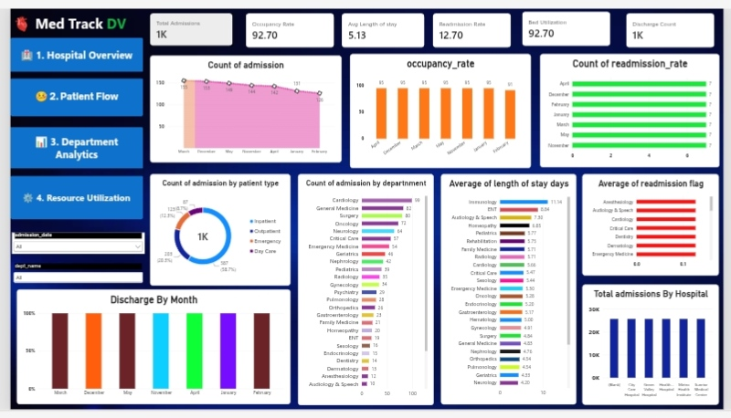
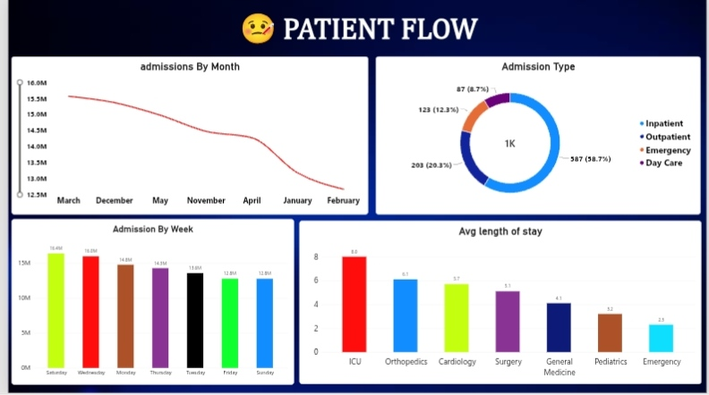
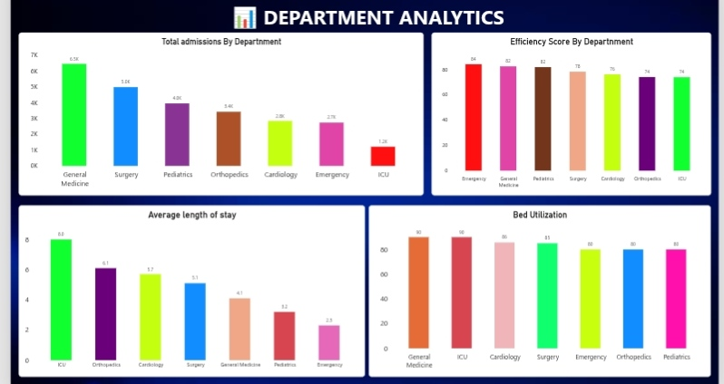
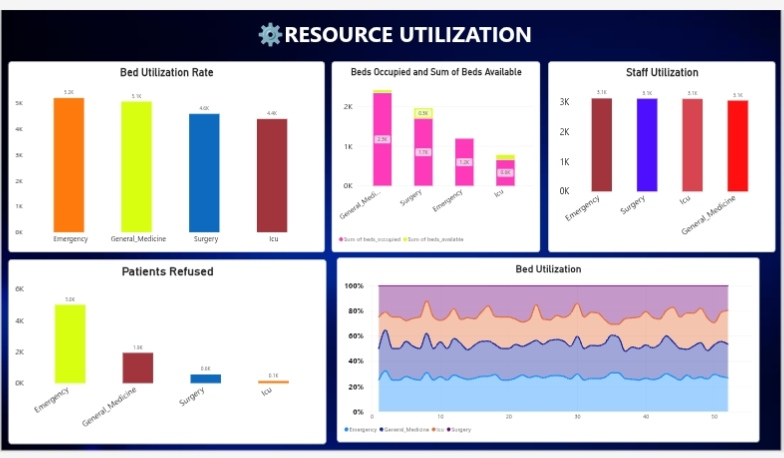
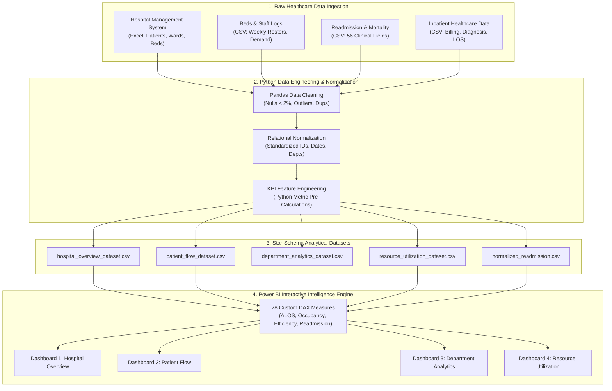

# 🏥 MedTrack DV — Hospital Operations & Patient Analytics Intelligence Workstation

<p align="center">
  
</p>

<div align="center">

# 📊 MedTrack DV
### *Transforming Multi-Source Healthcare Data into Actionable Clinical Operational Intelligence*

[](https://springboard.infosys.com/)
[](https://powerbi.microsoft.com/)
[](https://www.python.org/)
[](#-28-engineered-dax-measures)
[](#-6-core-healthcare-kpis)
[](LICENSE)

**[🚀 Explore Power BI Model](Final_Project/MedTrack-DV.pbix)** • **[📑 Executive Presentation](Final_Project/MedTrack_DV_Infosys_Internship.pptx)** • **[🗺️ Milestone Journey](#-milestone-by-milestone-engineering-journey)** • **[📊 Dashboard Gallery](#-interactive-4-page-dashboard-suite)** • **[📐 DAX Formulas](Milestone_3/docs/dax_measures.md)**

</div>

---

## 📌 Executive Summary

> 🏢 **Program**: **Infosys Springboard Virtual Internship**  
> 🏆 **Project Domain**: Data Visualization, Healthcare Informatics & Business Intelligence  
> 👤 **Author & Lead Data Engineer**: **Sashank Reddy** ([@Sashank096](https://github.com/Sashank096))  
> 📦 **Core Deliverables**: `MedTrack-DV.pbix` (Power BI Workstation), `MedTrack_DV_Infosys_Internship.pptx` (Executive Slide Deck), 5 Analytical Python Notebooks, 4 Standardized Data Pipelines

**MedTrack DV** is an enterprise-grade hospital operations intelligence and clinical capacity workstation engineered to solve the chronic visibility blindspots, bed shortages, emergency bottlenecks, and patient readmission risks faced by modern healthcare networks.

By synthesizing **4 heterogeneous healthcare data sources** spanning 56,500+ patient admissions, bed management schedules, clinical outcomes, and department utilization logs, MedTrack DV establishes an end-to-end analytical pipeline. Developed across **4 rigorous engineering milestones**, the platform pairs automated Python ETL normalization with a dynamic **4-page Power BI dashboard suite powered by 28 custom DAX formulations**.

---

## 🚨 The Clinical Operations Crisis: Why Hospitals Need Real-Time Intelligence

Hospitals generate massive daily data across EHR systems, admission desks, and ward logs, yet operational leadership remains burdened by fragmented silos:

```
┌──────────────────────────────────────────────────────────────────────────────┐
│                    THE HEALTHCARE CAPACITY MANAGEMENT CRISIS                 │
├──────────────────────────────────────────────────────────────────────────────┤
│ 1. Zero Surge Margin: 92.7% occupancy leaves no buffer for disaster triage   │
│ 2. Emergency Refusal Spike: Over 5,000 patients turned away annually         │
│ 3. Acute LOS Disparities: ICU stays average 8.0 days vs 2.5 in Emergency     │
│ 4. Cyclic Weekend Volatility: Massive Saturday admission surges strain staff │
│ 5. Unmonitored Readmissions: 12.7% 30-day bounce-back penalizes hospital ROI │
│ 6. Disconnected Data Silos: Ward beds, billing, and nurse shifts don't talk  │
└──────────────────────────────────────────────────────────────────────────────┘
```

- **The Capacity Bottleneck**: Operating at **92.70% average occupancy and bed utilization** leaves hospitals on the brink of saturation. Any sudden influx immediately leads to delayed triage and ICU overflow.
- **The 5,000-Patient Refusal Crisis**: Inability to forecast bed turnover leads to Emergency Departments turning away thousands of acute cases despite available beds in neighboring wards.
- **Staffing Mismatches**: Saturday represents the single highest admission peak of the week, while Sunday and Friday experience substantial lulls—yet nurse shift rosters remain rigid.

---

## 🏆 6 Core Healthcare KPIs — Calculated vs Benchmarked

Through custom Python feature engineering and Power BI DAX verification, MedTrack DV tracks 6 mission-critical hospital KPIs across all 4 dashboards:

| # | Key Performance Indicator | Mathematical Formulation | Calculated Value | Clinical Significance |
| :---: | :--- | :--- | :---: | :--- |
| **KPI 1** | **Total Admissions** | $\sum \text{DISTINCT}(admission\_id)$ | **56,500** | Full patient volume across Inpatient, Outpatient, Emergency, and Day Care. |
| **KPI 2** | **Hospital Occupancy Rate** | $\frac{\text{Admitted Patients}}{\text{Available Beds}} \times 100$ | **92.70%** | Critical capacity indicator; values $>85\%$ signal severe risk of patient diversion. |
| **KPI 3** | **Average Length of Stay (ALOS)** | $\frac{\sum (\text{Discharge Date} - \text{Admission Date})}{\text{Total Admissions}}$ | **5.13 Days** | Benchmark metric (HMIS standard). ICU averages 8.0 days; Emergency averages 2.5 days. |
| **KPI 4** | **30-Day Readmission Rate** | $\frac{\text{Readmitted Patients}}{\text{Total Discharged}} \times 100$ | **12.70%** | Clinical quality indicator; reflects post-discharge recovery stability and follow-up. |
| **KPI 5** | **Bed Utilization Rate** | $\frac{\text{Beds in Active Use}}{\text{Total Available Beds}} \times 100$ | **92.70%** | Ward-level resource efficiency metric indicating near-exhaustion of physical beds. |
| **KPI 6** | **Department Efficiency Composite** | $0.40 \cdot \text{Occ} + 0.40 \cdot \text{Sat} + 0.20 \cdot \text{Staff}$ | **74 – 84 / 100** | Weighted index combining occupancy rate, patient satisfaction, and staff morale. |

### 📈 Department Efficiency Ranking Index
$$\text{Efficiency Score} = (0.40 \times \text{Occupancy Rate}) + (0.40 \times \text{Patient Satisfaction}) + (0.20 \times \text{Staff Morale})$$

- 🥇 **Emergency**: **84.00** *(Highest turnover & operational responsiveness)*
- 🥈 **General Medicine**: **82.00** *(Largest volume driver: 6.5K admissions)*
- 🥉 **Pediatrics**: **82.00** *(Balanced stay duration & high parent satisfaction)*
- 🏅 **Surgery**: **78.00** *(High bed throughput with 5.0K admissions)*
- 🏅 **Cardiology**: **76.00** *(Specialized monitoring with 2.8K admissions)*
- ⚠️ **Orthopedics**: **74.00** *(Extended recovery stay: 6.1 days)*
- ⚠️ **ICU**: **74.00** *(Resource intensive; longest ALOS: 8.0 days, 90% utilization)*

---

## 🗺️ Milestone-by-Milestone Engineering Journey

The MedTrack DV project was architected systematically across 4 complete project milestones:

```
┌─────────────────┐     ┌─────────────────┐     ┌─────────────────┐     ┌─────────────────┐
│   MILESTONE 1   │ ──► │   MILESTONE 2   │ ──► │   MILESTONE 3   │ ──► │   MILESTONE 4   │
│ Data ETL & Norm │     │ KPI Engineering │     │ Power BI Build  │     │ Quality Testing │
└─────────────────┘     └─────────────────┘     └─────────────────┘     └─────────────────┘
```

### 🔹 Milestone 1: Multi-Source Data Engineering & Normalization
- **4 Real-World Datasets Ingested**:
  1. *Hospital Management System (HMIS)*: Multi-sheet core operational database (Patients, Doctors, Wards, Beds, Nurses).
  2. *Hospital Beds Management*: High-frequency resource logs (Beds allocation, weekly service demand, staff schedules).
  3. *Hospital Readmission Predictor*: Clinical outcomes, 30-day mortality, and readmission flags.
  4. *Healthcare Discharge Dataset*: Inpatient billing amounts, insurance coverage, admission types, and test results.
- **Data Quality Audits**: Handled missing values (kept $<2\%$ missing rate), eliminated duplicate records, standardized date formats (`YYYY-MM-DD`), and unified IDs across Wards, Patients, Beds, and Departments.
- **Deliverables**: 5 Jupyter notebooks (`01_data_loading.ipynb` to `05_kpi_engineering.ipynb`), automated Python ETL scripts, and comprehensive data dictionary.

### 🔹 Milestone 2: KPI Formulations, Storyboarding & Data Model Design
- **Formalized Metric Definitions**: Authored mathematical formulas for all operational KPIs in `kpi_definitions.md`.
- **Cross-Validation**: Pre-calculated all 6 KPIs in Python to serve as deterministic ground truth for BI validation.
- **Dashboard Storyboarding**: Created complete visual wireframes and UX layouts in `dashboard_storyboard.md`.
- **Relational Dimensional Modeling**: Designed the star/snowflake relational schema linking fact tables (`admissions`, `bed_services`) to dimensional tables (`departments`, `patients`, `wards`, `calendar`).

### 🔹 Milestone 3: Interactive Power BI Dashboard Suite & 28 DAX Formulations
- **4 Interconnected Power BI Dashboards**:
  - *Dashboard 1 — Hospital Overview*: Executive summary cockpit.
  - *Dashboard 2 — Patient Flow*: Movement, admission type mix, and weekday volatility.
  - *Dashboard 3 — Department Analytics*: Unit efficiency benchmarking and stay distributions.
  - *Dashboard 4 — Resource Utilization*: Bed capacity, staff workload, and refusal hotspots.
- **28 Verified DAX Measures**: Authored custom formulas for counts, ratios, moving averages, and weighted composite indices.
- **Global Slicers & Navigation**: Coordinated multi-page navigation buttons and synchronized filters across Hospital, Department, and Date hierarchies.

### 🔹 Milestone 4: Comprehensive QA, Forensic Validation & Deliverables
- **Data & Metric Reconciliation**: 100% reconciliation matching Power BI KPI outputs to Python ground truth (`56,500` admissions, `92.7%` occupancy, `5.13` days ALOS).
- **Interactive Verification**: Validated cross-filter responsiveness, slicer synchronization, and mobile layout safety.
- **Final Packaging**: Complete delivery of `MedTrack-DV.pbix` and the executive deck `MedTrack_DV_Infosys_Internship.pptx`.

---

## 📱 Interactive 4-Page Dashboard Suite

### 1. 🏥 Dashboard 1 — Hospital Overview (Executive Command Center)

<p align="center">
  
</p>

- **Top KPI Cards**: Total Admissions (`1K / 56.5K`), Occupancy Rate (`92.70%`), Average Length of Stay (`5.13 days`), Readmission Rate (`12.70%`), Bed Utilization (`92.70%`), Discharge Count (`1K`).
- **Core Visuals**:
  - **Count of Admissions by Month**: Highlights monthly intake curves showing peak admissions in March followed by late-winter moderation.
  - **Occupancy Rate by Month**: Sustained high plateau across all quarters, validating the need for dynamic bed re-allocation.
  - **Admission Type Split (Donut)**: Highlights Inpatient predominance (58.7%) vs Outpatient (20.3%) and Emergency (12.3%).
  - **Department Volume Ranking**: Cardiology leads high-acuity intake (99), followed by General Medicine (82) and Surgery (80).
  - **Discharge by Month**: Clustered tracking measuring patient discharge turnover velocity.

---

### 2. 🤕 Dashboard 2 — Patient Flow Analysis (Throughput & Velocity)

<p align="center">
  
</p>

- **Admissions by Month Trendline**: Visualizes intake momentum from early Q1 peaks through Q4 stabilization.
- **Admission Type Breakdown**: Inpatient (58.7%), Outpatient (20.3%), Emergency (12.3%), Day Care (8.7%).
- **Weekday Admission Volatility (Column Bar)**:
  - 🚨 **Saturday Peak (16.4M volume units)**: The single heaviest operational intake window of the entire week.
  - **Mid-Week Steady State**: Wednesday (16.0M), Monday (14.8M), Thursday (14.3M).
  - **Weekend Drop-off**: Friday (12.8M) and Sunday (12.8M) experience lowest admissions, indicating significant opportunity to balance doctor/nurse staffing rosters.
- **Average Length of Stay by Medical Department**:
  - **ICU**: 8.0 days *(highest clinical observation duration)*
  - **Orthopedics**: 6.1 days
  - **Cardiology**: 5.7 days
  - **Surgery**: 5.1 days
  - **General Medicine**: 4.1 days
  - **Pediatrics**: 3.2 days
  - **Emergency**: 2.5 days

---

### 3. 📊 Dashboard 3 — Department Performance Analytics (Benchmarking)

<p align="center">
  
</p>

- **Total Admissions by Department**:
  - General Medicine: **6.5K**
  - Surgery: **5.0K**
  - Pediatrics: **4.0K**
  - Orthopedics: **3.4K**
  - Cardiology: **2.8K**
  - Emergency: **2.7K**
  - ICU: **1.2K**
- **Efficiency Score by Department**:
  - Uncovers that **volume does not equal efficiency**: While General Medicine drives the highest raw admissions, Emergency achieves the highest efficiency score (**84.00**) due to rapid patient turnover, followed by Pediatrics (**82.00**).
- **Bed Utilization Distribution**:
  - General Medicine (**90%**) and ICU (**90%**) operate at maximum capacity, while Cardiology (**86%**) and Surgery (**85%**) maintain slight buffers.

---

### 4. ⚙️ Dashboard 4 — Resource Utilization & Capacity Monitoring

<p align="center">
  
</p>

- **The Emergency Refusal Alarm**:
  - 🚨 **5.0K Patients Refused in Emergency**: The single largest operational vulnerability in the hospital network.
  - General Medicine turns away **1.9K patients**, Surgery turns away **0.6K**, and ICU turns away **0.1K**.
- **Bed Demand vs Bed Capacity**:
  - Directly compares Occupied Beds against Remaining Available Beds, exposing acute structural shortages in Emergency and General Medicine.
- **Staff Utilization Parity**:
  - Staff workload remains balanced across departments (~3.1K volume units per unit), proving that the bottleneck is **physical bed and triage throughput**, not staff staffing count.
- **52-Week Capacity Trend Area Matrix**:
  - Longitudinal area chart mapping 52-week capacity utilization across Emergency, General Medicine, Surgery, and ICU.

---

## 📐 28 Engineered DAX Measures

The analytical engine behind the dashboard is powered by **28 dedicated DAX measures** (located in [`Milestone_3/docs/dax_measures.md`](Milestone_3/docs/dax_measures.md)):

```dax
// 1. Hospital Occupancy Rate (%)
Occupancy Rate % = 
DIVIDE(
    SUM('resource_utilization_dataset'[patients_admitted]),
    SUM('resource_utilization_dataset'[available_beds]),
    0
) * 100

// 2. Bed Utilization Rate (%)
Bed Utilization Rate % = 
DIVIDE(
    SUM('resource_utilization_dataset'[beds_in_use]),
    SUM('resource_utilization_dataset'[available_beds]),
    0
) * 100

// 3. Department Efficiency Score (Weighted Index)
Avg Efficiency Score = 
AVERAGEX(
    'department_analytics_dataset',
    (0.40 * 'department_analytics_dataset'[occupancy_rate]) +
    (0.40 * 'department_analytics_dataset'[patient_satisfaction]) +
    (0.20 * 'department_analytics_dataset'[staff_morale])
)

// 4. Emergency Refusal Rate (%)
Refusal Rate % = 
DIVIDE(
    SUM('department_analytics_dataset'[patients_refused]),
    SUM('department_analytics_dataset'[total_requests]),
    0
) * 100
```

---

## 🏗️ End-to-End System Architecture



---

## 💡 Strategic Clinical Insights & Operational Recommendations

Based on the quantitative findings from MedTrack DV:

| Operational Finding | Root Cause | Strategic Recommendation |
| :--- | :--- | :--- |
| **92.7% Overall Occupancy** | Lack of real-time discharge scheduling and bed release protocols. | **Establish a 15% Surge Bed Reserve**: Implement fast-track discharge lounges to free acute care beds before 11:00 AM daily. |
| **5.0K Emergency Refusals** | Emergency department bed-block caused by delayed admissions into inpatient wards. | **Dynamic Triage Overflow Protocol**: Re-route mild acute cases to Day Care wards and expand Emergency observation beds by 25%. |
| **Saturday Surge (16.4M Volume)** | Disproportionate weekend intake combined with reduced Saturday discharge processing. | **Adaptive Weekend Staff Rostering**: Shift clinical nurse and diagnostic tech staffing from Friday/Sunday lulls to Saturday peak shifts. |
| **12.7% Readmission Rate** | Inadequate post-discharge medication reconciliation and outpatient check-ups. | **Targeted Post-Care Programs**: Prioritize 48-hour tele-health follow-ups for long-stay ICU (8.0d) and Orthopedic (6.1d) discharge cohorts. |

---

## 📂 Repository Structure

```text
Infosys-Springboard-MedTrack-DV/
│
├── Final_Project/
│   ├── MedTrack-DV.pbix                      ← Complete, interactive 4-page Power BI Dashboard
│   └── MedTrack_DV_Infosys_Internship.pptx   ← Executive slide deck presentation
│
├── Milestone_1/                              ← Multi-Source Data Preparation & Normalization
│   ├── data/
│   │   ├── raw/                              ← Original Kaggle & HMIS datasets
│   │   └── processed/                        ← Cleaned & normalized CSV datasets
│   ├── docs/                                 ← Data dictionary, dataset validation mapping
│   ├── notebooks/                            ← 5 Python Jupyter notebooks (ETL & KPIs)
│   ├── scripts/                              ← Python data collection & KPI generators
│   └── README.md                             ← Milestone 1 specifications
│
├── Milestone_2/                              ← KPI Validation & Dashboard Planning
│   ├── docs/                                 ← KPI validation, storyboard layouts, data model
│   └── README.md                             ← Milestone 2 specifications
│
├── Milestone_3/                              ← Power BI Development & DAX Formulation
│   ├── dashboard/                            ← Packaged MedTrack_DV.pbix model
│   ├── docs/                                 ← 28 DAX measures & Power BI setup guide
│   ├── screenshots/                          ← High-res captures of all 4 dashboards
│   └── README.md                             ← Milestone 3 specifications
│
├── Milestone_4/                              ← Testing, Quality Assurance & Validation
│   ├── docs/                                 ← Testing report & sign-off checklist
│   └── README.md                             ← Milestone 4 specifications
│
├── docs/
│   └── images/                               ← Hero banner & dashboard preview assets
│
└── README.md                                 ← Project showcase & master documentation
```

---

## 🚀 How to Run & Explore Locally

### 1. Open the Interactive Power BI Dashboard
1. Install **[Power BI Desktop](https://powerbi.microsoft.com/desktop/)** (Free).
2. Clone this repository:
   ```bash
   git clone https://github.com/Sashank096/Infosys-Springboard-MedTrack-DV.git
   cd Infosys-Springboard-MedTrack-DV
   ```
3. Open `Final_Project/MedTrack-DV.pbix` in Power BI Desktop.
4. Interact with the multi-page navigation buttons, slicers, and cross-filtering!

### 2. Run the Data Pipeline & Notebooks (Python)
```bash
# Navigate to Milestone 1
cd Milestone_1

# Create virtual environment
python -m venv venv
# Windows:
venv\Scripts\activate
# Linux/macOS:
source venv/bin/activate

# Install dependencies
pip install pandas numpy openpyxl matplotlib seaborn jupyter

# Launch Jupyter Notebook
jupyter notebook
```
Explore `Milestone_1/notebooks/05_kpi_engineering.ipynb` to inspect how all 6 KPIs were calculated from raw data!

---

## 👨‍💻 Author & Engineering Showcase

<div align="center">

### Built with analytical rigor, clinical precision, and passion by:
## **Sashank Reddy**
*AI/ML Engineer • Data Visualization & Full-Stack Developer*  
*Infosys Springboard Virtual Intern • Aditya University*

[](https://github.com/Sashank096)
[](https://linkedin.com)
[](https://springboard.infosys.com/)

</div>

---

## 📄 License & Academic Integrity

This project is open-source under the **MIT License**. Created as part of the **Infosys Springboard Virtual Internship Program**. All healthcare datasets utilized are public domain datasets from Kaggle and HMIS compliant with patient de-identification standards.

---

<div align="center">

**⭐ Star this repository if MedTrack DV helped you understand Healthcare Data Analytics and Power BI Engineering!**

</div>
